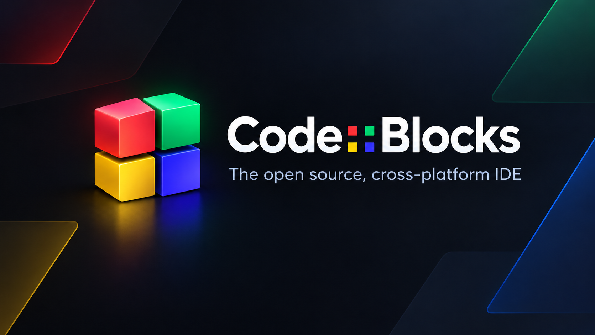

# Code::Blocks Custom Edition v25.03 (Dark Optimized)

*A fast, lightweight, and modern C/C++ IDE powered by a rock-solid native core, styled with full dark mode and pre-configured for instant productivity.*

**English** · [Română](README_RO.md)

---

**Code::Blocks Custom Edition (Dark Optimized)** is a focused modernization of the classic Code::Blocks IDE. It keeps the rock-solid native core, the familiar project/build workflow, and the plugin ecosystem, while adding a complete dark interface, modern visual assets, targeted performance tuning, and a clean per-user installer.

The goal is simple: a C/C++ IDE that feels fast and modern on Windows 10/11 x64 — without Electron overhead, telemetry, or an administrator prompt.

## Overview

This edition is built on **Code::Blocks 25.03**, with the UI layer ported to **wxWidgets 3.2.11** and compiled with **GCC 16.1.0** in the MSYS2 UCRT64 environment. The original native architecture is preserved; the changes are concentrated in the areas that affect daily comfort and speed: theme rendering, icons, editor colors, startup behavior, logging, and compiler integration.

| | |
| --- | --- |
| **Release** | 25.03 |
| **Base IDE** | Code::Blocks 25.03 |
| **UI toolkit** | wxWidgets 3.2.11 |
| **Toolchain** | GCC 16.1.0 · MSYS2 UCRT64 |
| **Platform** | Windows 10 / 11 · x64 |
| **Installer** | Inno Setup 6 · per-user · no UAC |
| **License** | GNU GPL v3.0 |

## Key Features

### 🌑 Full Dark UI & Scintilla Style

Every major surface is dark: menu bar, title bar, toolbar, AUI panels, tabs, logs, dialogs, scrollbars, and common native controls. The Scintilla editor uses a tuned palette with cyan keywords, soft green comments, and magenta literals. **Matching braces are pre-configured to bright red `#FF0000`, bold, on a subtle dark background (`#13181D`)** — the pair is impossible to miss.

The visual layer also includes modern SVG toolbar icons, a redesigned Start Here page, a new splash screen, and an updated application icon, all crisp at High-DPI.

### ⚡ Native Performance

Built on the native Code::Blocks core, not a web wrapper. Typical editing sessions stay around **50 MB RAM**, and the IDE opens without a splash-screen wait. Workspace loading is deferred until the main window is visible, the theme is applied in a single pass, log writes are batched, and compiler settings are cached.

The Stage 1 optimizations are documented in detail in the release notes.

### 🌍 Dual-Language Support

The installer is fully bilingual (**Română / English**) and configures the IDE locale (`ro_RO` or `en`) to match your choice. Documentation and release notes are maintained in both languages, and the installer's Finish page opens the correct file automatically.

### 🧩 Windows Explorer Integration

Optional per-user tasks let you:

- associate `.cbp`, `.cpp`, `.c`, and `.h` files with Code::Blocks;
- add the Code::Blocks `bin` folder to `%PATH%`;
- add **Open with Code::Blocks** to the Explorer context menu for folders and C/C++ files.

All changes are written under `HKCU` and are cleanly reverted on uninstall. Existing associations and `OpenWithProgids` entries are preserved.

### 📦 Per-User, UAC-Free Installer

The installer targets `%LOCALAPPDATA%\Programs\CodeBlocks Custom Edition` by default and requires **no administrator rights**. Your existing `%APPDATA%\codeblocks\default.conf` is preserved, so upgrades do not wipe your settings.

The desktop shortcut is named exactly **CodeBlocks**, and the Finish page offers an optional shortcut to the release notes. A silent-install mode is available for automated deployments.

## Download & Quick Start

### 1. Download

Open the **[Releases](../../releases)** page and download the latest `setup.exe` (about 28 MB).

> **Windows SmartScreen:** the executable is not code-signed. If Windows shows a warning, verify that you downloaded it from this repository, then choose **More info → Run anyway**.

### 2. Install

1. Run `setup.exe`.
2. Choose **Română** or **English**.
3. Keep the default per-user location or select another folder.
4. Select the optional tasks you want: desktop shortcut, file associations, `%PATH%`, Explorer context menu.
5. Click **Install**, then **Finish**.

No UAC prompt is required. The installer writes only to your user profile and `HKCU`.

### 3. First Launch

- Code::Blocks starts with the Dark theme and the locale you selected.
- If no external compiler is found, install **MSYS2 UCRT64** or **MinGW-w64**, then configure it under `Settings → Compiler → Toolchain executables`.
- A typical MSYS2 UCRT64 toolchain path is `C:\msys64\ucrt64\bin`.
- The IDE can usually auto-detect a correctly installed compiler on first run.

## Documentation & Release Notes

The full changelog is split by language:

| File | Language | Contents |
| --- | --- | --- |
| [MODIFICATIONS_EN.md](MODIFICATIONS_EN.md) | English | Complete English changelog |
| [MODIFICATIONS_RO.md](MODIFICATIONS_RO.md) | Română | Complete Romanian changelog |

The release notes cover the visual redesign, the native dark-mode implementation, the wxWidgets 3.2 migration, the Stage 1 performance work (deferred workspace loading, single theme pass, batched log writes, compiler-settings cache), the Start Here updates, and the final build verification.

The installer's **Finish** page can open the release notes for the language selected during setup.

For build instructions, see [BUILD](BUILD). For the upstream license text, see [COPYING](COPYING).

## Credits & License

**Created and optimized by tudor62.**

- Original Code::Blocks core, SDK, and plugin architecture: Yiannis Mandravellos and the Code::Blocks contributors.
- Built with wxWidgets 3.2.11 and GCC 16.1.0 (MSYS2 UCRT64).
- Modern icons, splash screen, and Start Here assets designed for this edition.

**License:** GNU General Public License v3.0 — see [COPYING](COPYING).

This is an independent, unofficial custom edition. It is not affiliated with or endorsed by the official Code::Blocks project. Code::Blocks remains the property of its original authors and contributors.

---

**English** · [Română](README_RO.md)

Maintained by tudor62 · Built for the C/C++ community

